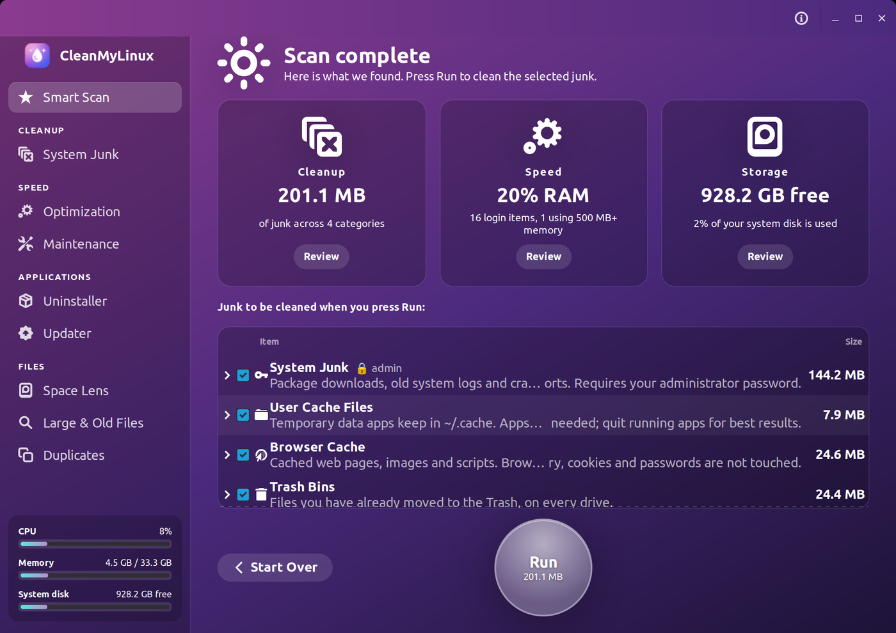
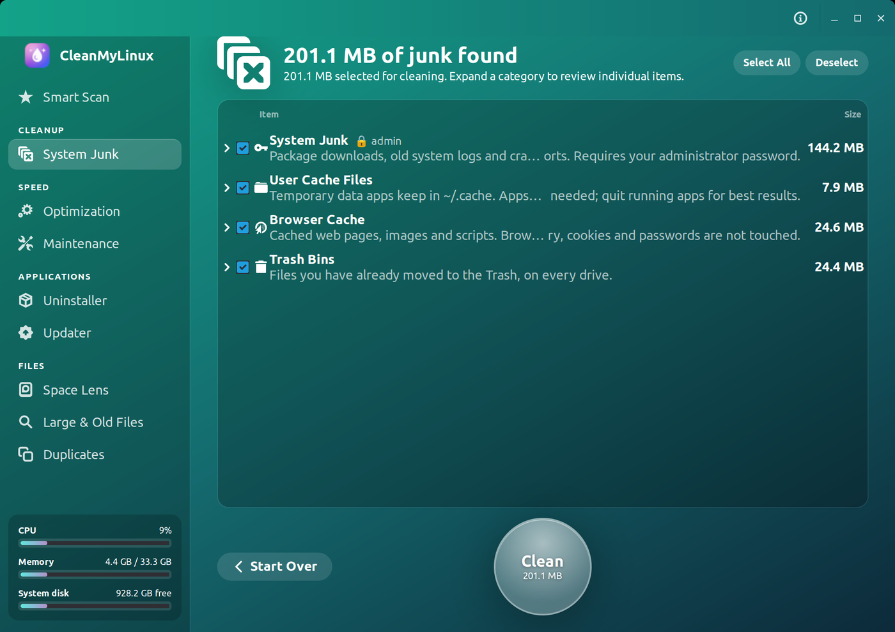
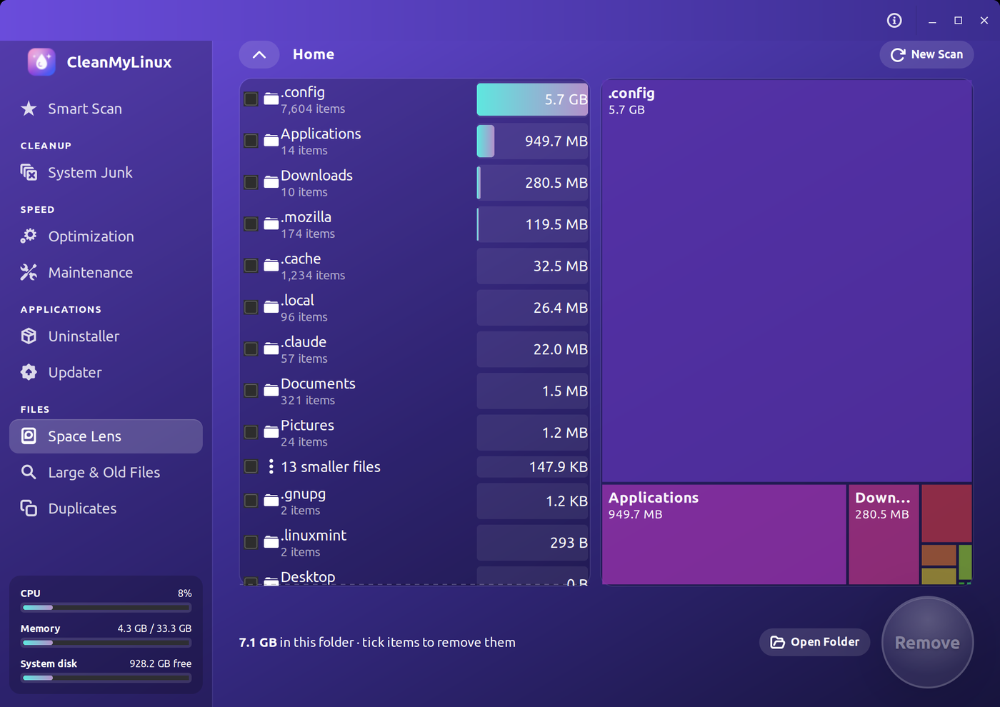
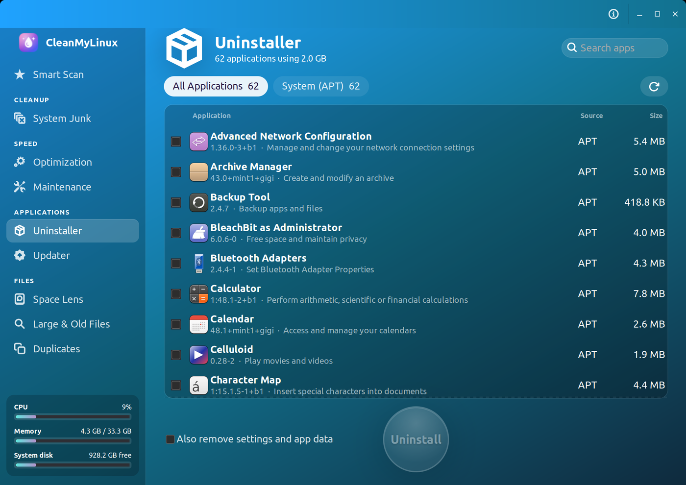
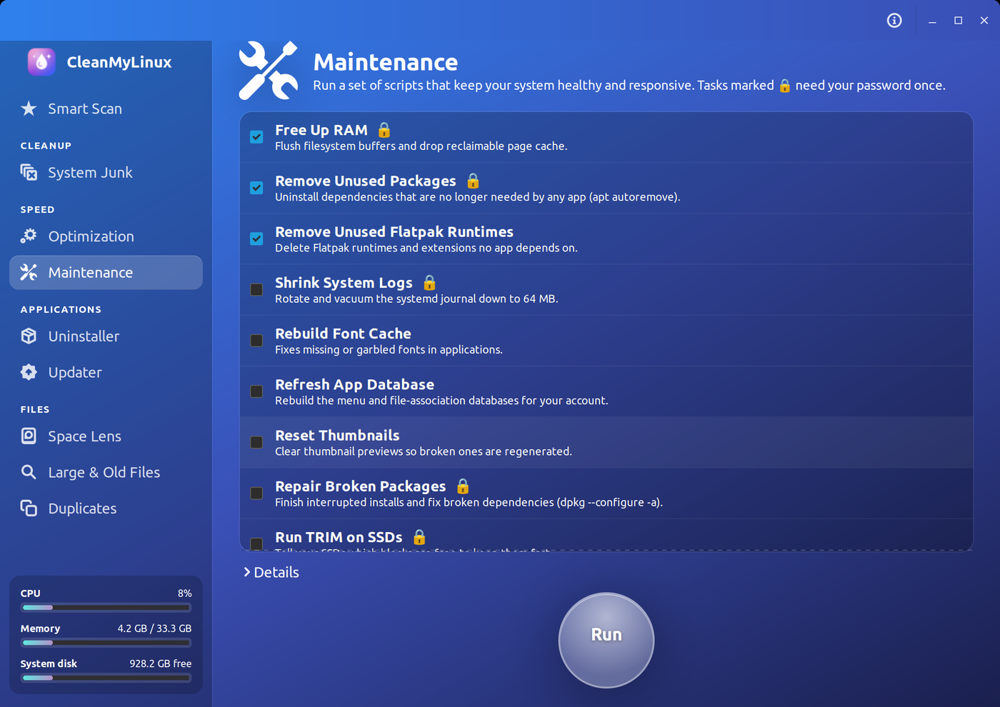
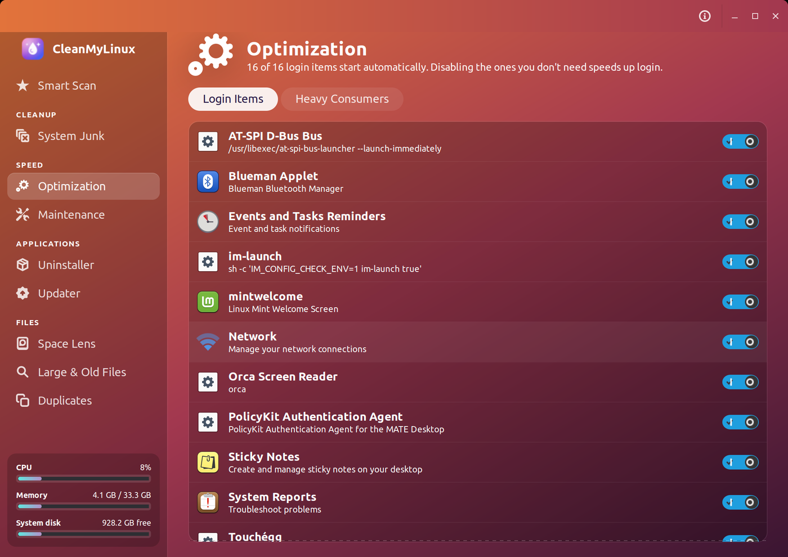

# CleanMyLinux

A CleanMyMac-style cleaner, uninstaller and updater for **Linux**, built
with Python + GTK3. It runs on any modern Linux desktop (Ubuntu, Debian,
Linux Mint, Pop!_OS, Fedora, openSUSE, Arch and their derivatives) under
GNOME, KDE Plasma, Cinnamon, Xfce, MATE and others.

<p align="center">
  
  
</p>
<p align="center">
  
  
</p>
<p align="center">
  
  
</p>
<p align="center"><em>Smart Scan · System Junk · Space Lens · Uninstaller · Maintenance · Optimization</em></p>

## Features

| Module | What it does |
| --- | --- |
| **Smart Scan** | One-click scan: junk total, RAM, login items and disk health, then cleans the junk. |
| **System Junk** | User caches, browser caches (history, cookies and passwords are left alone), thumbnails, developer caches (pip, npm, cargo, gradle…), old logs, partial downloads and every Trash bin. Admin items: APT cache, systemd journal, rotated `/var/log` files, crash reports. |
| **Optimization** | Turn login items (`~/.config/autostart`, `/etc/xdg/autostart`) on or off, and quit apps that use the most CPU or memory. |
| **Maintenance** | Free RAM, `apt autoremove`, remove unused Flatpak runtimes, shrink the journal, rebuild the font cache, refresh the app database, reset thumbnails, repair broken packages, TRIM SSDs. |
| **Uninstaller** | Remove APT, Flatpak and Snap apps, plus data left behind by removed Flatpak apps. Before removing anything it shows every package APT would take with it. Essential packages are locked. |
| **Updater** | Check APT, Flatpak and Snap updates in one list, with security fixes flagged and download sizes shown, then install the ones you pick. Can refresh package lists first. The sidebar badge shows how many updates are pending. |
| **Space Lens** | A clickable treemap of any folder (or the whole disk) to find what is eating space. |
| **Large & Old Files** | Finds big files and files you haven't used in over a year, grouped by type. |
| **Duplicates** | Finds files that are byte-for-byte identical (by size, then a partial hash, then a full BLAKE2 hash). The oldest copy is always kept. |

## Install

Get the files from the
[latest release](https://github.com/thuutien/cleanmylinux/releases/latest).

### One-liner (any supported distro)

```bash
curl -fsSL https://raw.githubusercontent.com/thuutien/cleanmylinux/master/packaging/quick-install.sh | sudo bash
```

This installs dependencies via `apt` / `dnf` / `pacman` / `zypper`,
downloads the release tarball and runs the installer. Variants:

```bash
curl -fsSL .../quick-install.sh | sudo bash -s -- 1.0.0      # pin a version
curl -fsSL .../quick-install.sh | sudo bash -s -- --no-deps  # skip dependency install
curl -fsSL .../quick-install.sh | sudo bash -s -- --uninstall
```

### Debian / Ubuntu / Linux Mint / Pop!_OS (.deb)

```bash
sudo apt install ./cleanmylinux_1.0.0_all.deb
```

`apt` pulls in all dependencies.

### Flatpak (any distro)

Download `cleanmylinux-<version>-x86_64.flatpak` from the release page, then:

```bash
flatpak install --user ./cleanmylinux-1.0.0-x86_64.flatpak
flatpak run io.github.thuutien.CleanMyLinux
```

The Flatpak bundles the interface. Package management, process listing and
admin tasks still use your system's own tools (`apt`, `flatpak`, `ps`,
polkit, Python 3) through `flatpak-spawn --host`. Most desktops already have
them. Flatpak bundles are built automatically by GitHub Actions on every push.

### Arch Linux

A `PKGBUILD` is in [`packaging/arch`](packaging/arch):

```bash
cd packaging/arch && makepkg -si
```

### Any distro (tarball)

```bash
tar xzf cleanmylinux-1.0.0.tar.gz && cd cleanmylinux-1.0.0 && sudo ./install.sh
```

Needs Python 3 with GObject bindings, GTK 3, `psutil` and polkit. Remove it
again with `sudo ./install.sh --uninstall`.

### Updating

Open the menu (☰) and choose **Check for Updates…**. By default CleanMyLinux
also checks at startup and shows an **Update available** card in the sidebar when a new
release is out. It downloads the package that matches how you installed it,
verifies it against the SHA-256 checksum GitHub publishes, then installs it:

- `.deb` and tarball installs: through `pkexec`, so you're asked for your password.
- Flatpak: with `flatpak install`, no password needed.
- Arch packages and source checkouts: you update those yourself. The dialog
  links to the release page.

## Build the packages yourself

```bash
./packaging/build-deb.sh       # dist/cleanmylinux_<version>_all.deb
./packaging/build-tarball.sh   # dist/cleanmylinux-<version>.tar.gz
./packaging/build-flatpak.sh   # dist/cleanmylinux-<version>-x86_64.flatpak
```

The Flatpak build needs `flatpak-builder` and the GNOME 50 SDK from Flathub.

## Run from source

```bash
./bin/cleanmylinux
```

## How it works

- Scanning and cleaning live in `cleanmylinux/core` and have no GTK
  dependency. The GTK interface is in `cleanmylinux/ui`.
- Files you pick in Large Files, Duplicates and Space Lens go to the
  **Trash**. They are not deleted outright. Cache and Trash folders are
  emptied, not removed.
- A hard guard refuses to delete `/`, `$HOME`, `~/.config`, `~/.local` and
  other system roots.
- Admin tasks run through `pkexec` to a small helper
  (`/usr/lib/cleanmylinux/cleanmylinux-helper`, registered with polkit). It
  only accepts a fixed list of actions and checks package names before
  passing them to `apt-get`. You enter your password once per run.
- Login items are changed through per-user overrides. System files are
  never edited.

## Limitations

- APT is the only system package manager supported for uninstalling and
  updating. On Fedora, openSUSE and Arch, those two modules only handle
  Flatpak and Snap apps.
- In the Flatpak build, Space Lens can only map your home folder, and the
  Uninstaller can't detect leftovers from removed Flatpak apps.

## License

MIT. See [LICENSE](LICENSE).
